# Nystara architecture

This document is the architecture reference for Nystara. It has five parts:

- **Part I, High-level design (HLD):** goals, system context, containers,
  deployment and the main design decisions.
- **Part II, Low-level design (LLD):** one section per module, with numbered
  sequence diagrams and flowcharts.
- **Part III, Data design:** the entity relationship diagram (ERD) and model rules.
- **Part IV, Operations:** build, deploy, CI and testing.
- **Part V, Implementation plan:** what is not built yet, the proposed design for
  it, and the order to build it in.

Parts I to IV describe the system **as built**. Each section names the files that
implement it, so the details can be checked in code. Anything not built yet is
marked **Proposed** and appears only in Part V.

Diagrams are [Mermaid](https://mermaid.js.org/) and render on GitHub. In sequence
diagrams the numbers are the step order. In flowcharts, numbered boxes are steps
in the order they run.

## Contents

- **Part I: High-level design**
  - [1. Goals and quality attributes](#1-goals-and-quality-attributes)
  - [2. System context](#2-system-context)
  - [3. Container and component view](#3-container-and-component-view)
  - [4. Deployment view](#4-deployment-view)
  - [5. Key decisions](#5-key-decisions)
- **Part II: Low-level design**
  - [6. LLD-1 Request pipeline](#6-lld-1-request-pipeline)
  - [7. LLD-2 Reader authentication](#7-lld-2-reader-authentication)
  - [8. LLD-3 Second factors](#8-lld-3-second-factors)
  - [9. LLD-4 Admin authentication](#9-lld-4-admin-authentication)
  - [10. LLD-5 Reading and the paywall](#10-lld-5-reading-and-the-paywall)
  - [11. LLD-6 Reader engagement](#11-lld-6-reader-engagement)
  - [12. LLD-7 Writing and story documents](#12-lld-7-writing-and-story-documents)
  - [13. LLD-8 Media: images and video](#13-lld-8-media-images-and-video)
  - [14. LLD-9 AI editor](#14-lld-9-ai-editor)
  - [15. LLD-10 Admin console](#15-lld-10-admin-console)
  - [16. LLD-11 Frontend structure](#16-lld-11-frontend-structure)
  - [17. LLD-12 Privacy and data lifecycle](#17-lld-12-privacy-and-data-lifecycle)
- **Part III: Data design**
  - [18. Entity relationship diagram](#18-entity-relationship-diagram)
  - [19. Model rules](#19-model-rules)
- **Part IV: Operations**
  - [20. Build, deploy and CI](#20-build-deploy-and-ci)
  - [21. Testing](#21-testing)
- **Part V: Implementation plan**
  - [22. Gap analysis](#22-gap-analysis)
  - [23. Proposed designs](#23-proposed-designs)
  - [24. Phased plan](#24-phased-plan)
  - [25. Risks and open questions](#25-risks-and-open-questions)

---

## Part I: High-level design

## 1. Goals and quality attributes

Nystara is a long-form blogging platform. Writers create rich stories, readers
read, react and comment, and members get unlimited members-only stories and an
AI editor.

### Functional scope (built)

| Capability | Summary |
| --- | --- |
| Accounts | Email link, Google, GitHub and passkey sign-in; a second factor is required for every reader account |
| Writing | Word-style rich editor, six document themes, images, video embeds, drafts kept in the browser |
| Reading | Server-rendered stories, metered paywall for members-only stories (5 per 30 days) |
| Engagement | Guest and member comments with one level of replies, like/dislike, 1–5 ratings, trending and most-viewed lists, share links |
| AI editor | Polish, shorten, expand, outline, titles and feedback for members |
| Admin | Separate console for users and articles, with its own login and optional MFA |
| Privacy | Self-service export and erasure, data retention cleanup, audit events |

### Quality attributes

| Attribute | Target | How the design meets it |
| --- | --- | --- |
| Security | No unauthorised write, no stored XSS, no account takeover from one stolen secret | Same-origin writes, allow-listed document format, fixed renderer, strict CSP nonce, mandatory reader MFA, admin session versioning |
| Abuse resistance | Credential endpoints cannot be brute-forced | Three IP rate-limit tiers plus per-user, per-email and per-account limits; Turnstile on sign-in, admin login and guest comments |
| Availability under dependency failure | Fail safe, not open | Rate limiter and virus scanner fail closed; optional services return `503` when not configured |
| Horizontal scale | Any number of identical app replicas | No in-process state in production: sessions in PostgreSQL, limits in Redis, paywall serialised with a PostgreSQL advisory lock |
| Privacy | Minimum data, full erasure | Random reader ids (no fingerprinting), HMAC-keyed Redis keys, cascading deletes, EXIF stripped from images, AI calls with `store: false` |
| Operability | One image, one command to start | Standalone Next.js Docker image; migrations run on container start; `/api/health` for liveness |

### Constraints

- One Next.js 16 application (App Router, React 19, TypeScript strict).
- PostgreSQL 16 through Prisma 7; Redis 7 for rate limits.
- No background workers or message queues today. Everything runs inside a
  request, except the retention cleanup, which an operator runs.

---

## 2. System context

Who and what Nystara talks to.

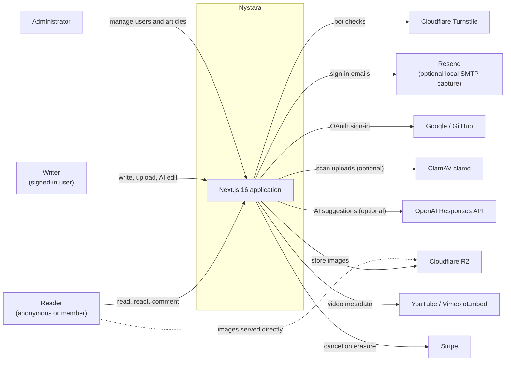

| External system | Used for | Required |
| --- | --- | --- |
| Cloudflare Turnstile | Bot check on email/OAuth sign-in, admin login, guest comments | Yes |
| Resend | Sign-in, account/activity emails and digests in all environments (optional local SMTP capture) | Yes, for email sign-in |
| Google, GitHub | OAuth sign-in | Optional |
| Cloudflare R2 | Public image storage | Optional (uploads return `503` without it) |
| ClamAV | Upload virus scanning | Optional (fails closed when configured) |
| OpenAI | AI editor | Optional (`503` without it) |
| YouTube, Vimeo | oEmbed lookups for video embeds | Used on demand |
| Stripe | Cancelling a subscription during account erasure | Needed once any subscription exists |

---

## 3. Container and component view

### 3.1 Containers

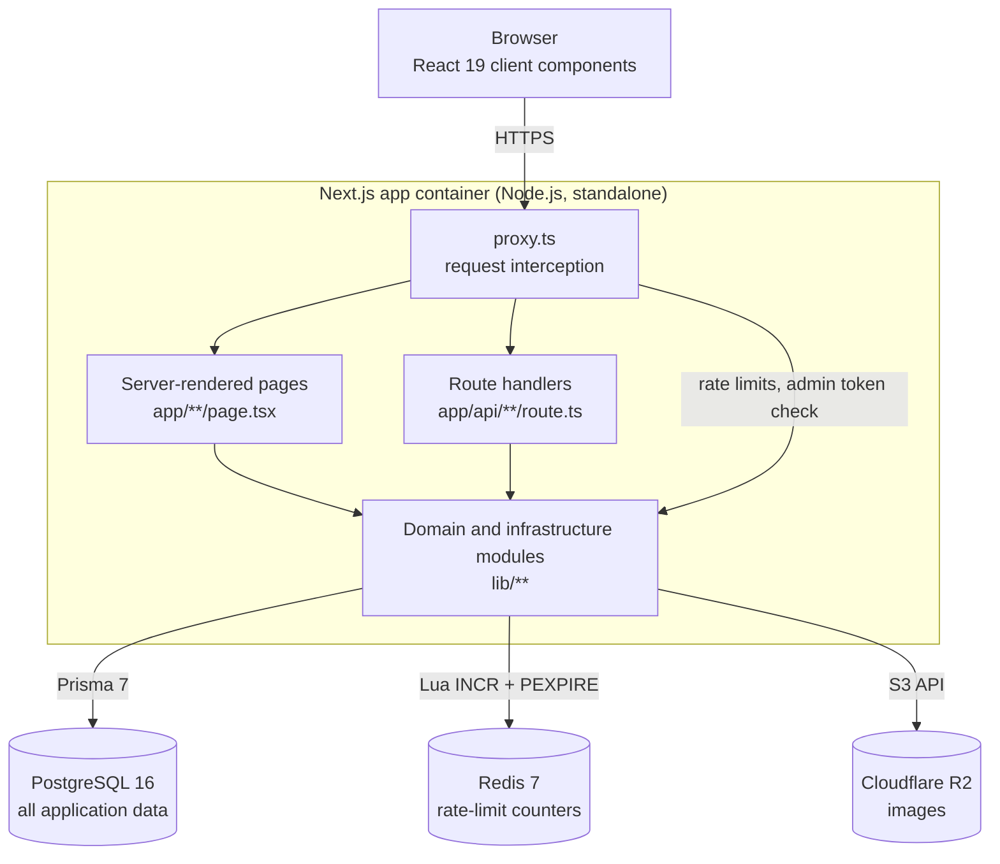

### 3.2 Components inside the app

| Layer | Component | Files | Responsibility |
| --- | --- | --- | --- |
| Edge of app | Proxy | `proxy.ts` | Same-origin writes, rate limit tiers, body limit, CSP nonce, admin page guard, reader cookie |
| Edge of app | Static headers | `next.config.ts` | HSTS, frame denial, nosniff, referrer, permissions policy, COOP |
| Request helpers | Request utils | `lib/request.ts`, `lib/client-ip.ts`, `lib/csp.ts`, `lib/rate-limit.ts` | Body reading, IP resolution, CSP string, limiter |
| Identity | Reader auth | `auth.config.ts`, `lib/auth.ts`, `lib/auth-adapter.ts`, `lib/user-session.ts` | Auth.js config, session accessors, passkey sessions |
| Identity | Second factors | `lib/mfa/*` | Passkeys, TOTP, recovery codes, security actions |
| Identity | Admin auth | `lib/admin-session.ts`, `lib/admin-auth.ts`, `lib/password.ts` | Admin JWT, database version check, password rules |
| Identity | Bot checks | `lib/turnstile.ts`, `lib/oauth-turnstile.ts` | Turnstile verification, OAuth pre-check cookie |
| Reading | Paywall and premium | `lib/paywall.ts`, `lib/premium.ts` | Metered access, membership check |
| Billing | Pro plan and Stripe | `lib/pro.ts`, `lib/plans.ts`, `lib/billing.ts`, `lib/stripe.ts` | Launch switch, Pro entitlement, webhook sync |
| Engagement | Engagement | `lib/engagement.ts`, `lib/visitor.ts`, `lib/comments.ts` | Voter identity, views, feedback, trending, comments |
| Writing | Story documents | `lib/story-document.ts`, `lib/article-schema.ts`, `lib/story-theme.ts`, `lib/slug.ts`, `lib/local-draft.ts` | Document schema, text extraction, themes, slugs, browser drafts |
| Media | Media | `lib/image-pipeline.ts`, `lib/image-type.ts`, `lib/clamav.ts`, `lib/r2.ts`, `lib/storage-url.ts`, `lib/video.ts` | Validation, scanning, re-encoding, storage, oEmbed |
| AI | AI editor | `lib/ai-editor.ts` | Action prompts and response parsing |
| Privacy | Privacy | `lib/gdpr.ts`, `lib/audit.ts`, `scripts/cleanup.ts` | Erasure, audit log, retention |
| Platform | Infrastructure | `lib/prisma.ts`, `lib/env.ts`, `lib/resend.ts`, `lib/stripe.ts` | Clients and environment |

### 3.3 Route map

| Area | Pages | API |
| --- | --- | --- |
| Public | `/`, `/about`, `/features`, `/pricing`, `/why-blog`, `/privacy`, `/terms`, `/cookies`, `/contact` | `GET /api/articles`, `GET /api/health` |
| Billing | `/pricing`, `/settings/billing` | `/api/billing/checkout`, `/api/billing/portal`, `/api/stripe/webhook` |
| Auth | `/login`, `/signup`, `/verify`, `/mfa`, `/sign-in-error` | `/api/auth/[...nextauth]`, `/api/auth/magic-link`, `/api/auth/oauth-turnstile`, `/api/auth/mfa/{options,verify}`, `/api/auth/passkey/{options,verify}` |
| Reading | `/{username}`, `/{username}/{slug}` | `/api/articles/{id}/comments`, `/api/articles/{id}/feedback`, `/api/comments/{id}` |
| Writing | `/new-story`, `/editor/{id}`, `/ai-editor` | `POST /api/articles`, `PATCH`/`DELETE /api/articles/{id}`, `/api/articles/{id}/publish`, `/api/media`, `/api/videos`, `/api/ai/editor` |
| Account | `/me/stories`, `/me/library`, `/me/stats`, `/me/audience`, `/me/following`, `/me/security`, `/me/help`, `/settings` | `/api/me`, `/api/me/export`, `/api/me/security/*` |
| Admin | `/admin/login`, `/admin/dashboard`, `/admin/users`, `/admin/articles`, `/admin/profile`, `/admin/security`, `/admin/settings` | `/api/admin/*` |

Full request and response shapes are in [API.md](API.md).

---

## 4. Deployment view

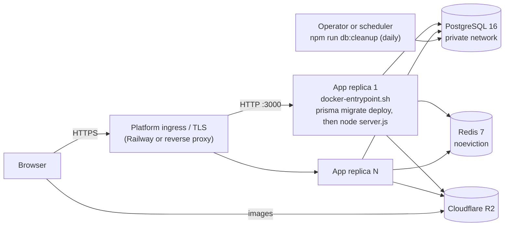

| Environment | How it runs |
| --- | --- |
| Local | `./start.sh`: app on 6100, PostgreSQL 5442, Redis 6389, optional Mailpit 8035 (`EMAIL_PROVIDER=smtp`, `docker-compose.dev.yml`) |
| Self-hosted | `docker-compose.yml`: PostgreSQL, Redis (128 MB, `noeviction`), app built from `Dockerfile` |
| Railway | `railway.toml`: Dockerfile build, start `./docker-entrypoint.sh node server.js`, health check `/api/health`, restart on failure (3 retries) |

Rules that matter for scaling:

- Replicas are stateless. Every replica must share the same PostgreSQL and Redis.
- Set `TRUST_PROXY_IP=1` only when the ingress overwrites `X-Forwarded-For` and
  the app cannot be reached directly.
- Migrations run on every container start (`prisma migrate deploy`), so a
  migration must be safe to run while older replicas still serve traffic.

Environment variables and the launch checklist are in [DEPLOY.md](DEPLOY.md).

---

## 5. Key decisions

| # | Decision | Choice | Reason | Trade-off accepted |
| --- | --- | --- | --- | --- |
| D1 | Application shape | One Next.js app | SSR and API in one deployable; no service boundaries to maintain yet | All features scale together |
| D2 | Request interception | `proxy.ts` owns origin, rate limit, body limit and CSP | One place to audit; handlers stay small | Every request pays for a Redis call |
| D3 | Reader sessions | Auth.js database sessions | Revocable; carry `mfaVerifiedAt` | One database read per authenticated request |
| D4 | Admin sessions | Separate 8-hour JWT plus database version check | Isolates admin access; fast revocation | Two auth systems to maintain |
| D5 | Second factor | Required for readers, optional for admins | Every reader account is protected from day one; admins also need password and Turnstile | Extra step at sign-up |
| D6 | Paywall | Server-side excerpt, advisory lock per reader | Full content never reaches over-quota clients; quota holds under concurrency | Soft meter: clearing cookies resets it |
| D7 | Anonymous identity | Random signed cookie | Guest votes and quota without fingerprinting | Identity is per browser |
| D8 | Rate limits | Redis, fail closed in production | Limits hold across replicas; an outage denies rather than opens | Redis is a hard dependency |
| D9 | Images | Server re-encode to WebP on R2 | Removes metadata and appended payloads; predictable sizes; cheap egress | CPU per upload; images in drafts are public |
| D10 | Document storage | Tiptap JSON plus plain text, allow-list validated | Rich formatting without storing or rendering raw HTML | New node types need schema and renderer changes |
| D11 | AI | Direct `fetch` to the Responses API | No SDK dependency; strict timeout, output cap, `store: false` | Provider-specific request shape |
| D12 | Search (future) | PostgreSQL full-text | Column and index already exist; no extra service | Less relevance tuning than a search engine |

---

## Part II: Low-level design

## 6. LLD-1 Request pipeline

`proxy.ts` runs before every path except `_next/static`, `_next/image` and the
favicon. Handlers must not repeat its checks.

### 6.1 Proxy flow

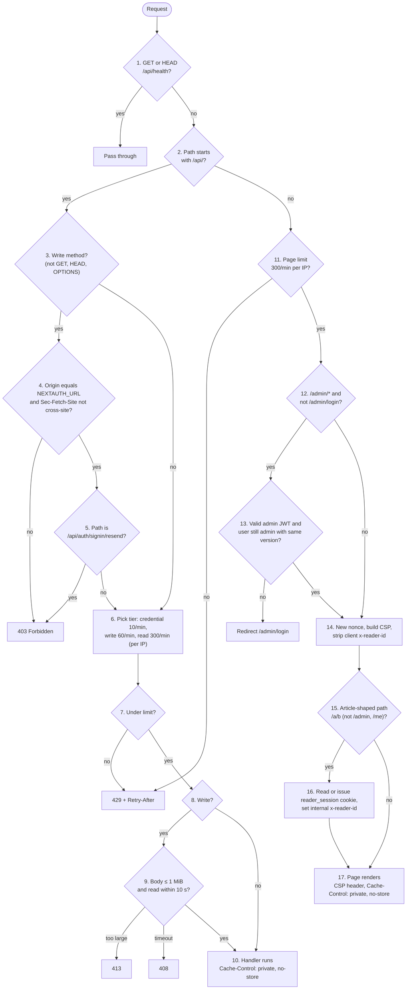

Credential tier paths: `/api/admin/login`, `/api/auth/magic-link`,
`/api/auth/oauth-turnstile`, and the prefixes `/api/auth/mfa/`,
`/api/auth/passkey/`, `/api/admin/login/`, `/api/me/security/`,
`/api/admin/security/`.

Route handlers then apply their own per-user or per-reader limits (uploads, AI,
comments, votes, export, email links, MFA attempts).

### 6.2 Content Security Policy (`lib/csp.ts`)

`script-src 'self' 'nonce-…' 'strict-dynamic'` plus Turnstile; frames limited to
Turnstile, YouTube and Vimeo; `frame-ancestors 'none'`; `object-src 'none'`.
Development adds `'unsafe-eval'`; production adds `upgrade-insecure-requests`.

### 6.3 Rate limiter (`lib/rate-limit.ts`)

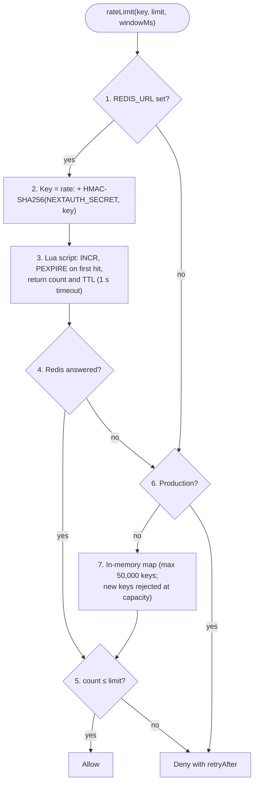

Client IP (`lib/client-ip.ts`) is the last `X-Forwarded-For` entry only when
`TRUST_PROXY_IP=1`. Otherwise every client shares the IP bucket `unknown`, and
per-user and per-email limits still apply. Redis never stores raw emails, user
ids or IPs.

---

## 7. LLD-2 Reader authentication

Auth.js handles readers and writers. The admin console uses a separate system
(LLD-4).

### 7.1 Sign-in methods

| Method | Entry point | Bot check | Second factor |
| --- | --- | --- | --- |
| Email link | `POST /api/auth/magic-link` (`intent: login` or `signup`) | Turnstile | Required on `/mfa` |
| Google / GitHub | `POST /api/auth/oauth-turnstile`, then Auth.js OAuth | Turnstile, via a 5-minute signed cookie | Required on `/mfa` |
| Passkey | `POST /api/auth/passkey/{options,verify}` | None needed | The passkey counts as the second factor |

New users get a random public username `writer-{uuid}` (`events.createUser`), so
the email address never appears in URLs. `lib/auth-adapter.ts` wraps the Prisma
adapter so deleting an already-deleted session succeeds; a stale cookie no
longer breaks sign-in or sign-out.

### 7.2 Sequence: email link sign-up

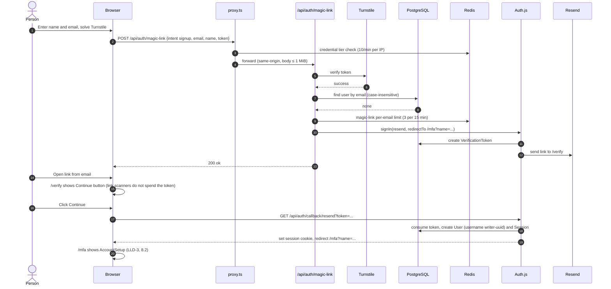

A login uses `intent: "login"`: it returns `404 no_account` when no account
exists. A sign-up for an existing email returns `409 account_exists`.

### 7.3 Sequence: OAuth sign-in with Turnstile

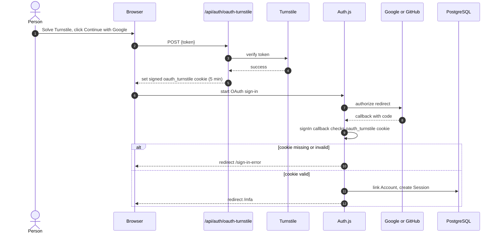

### 7.4 Sequence: passkey sign-in

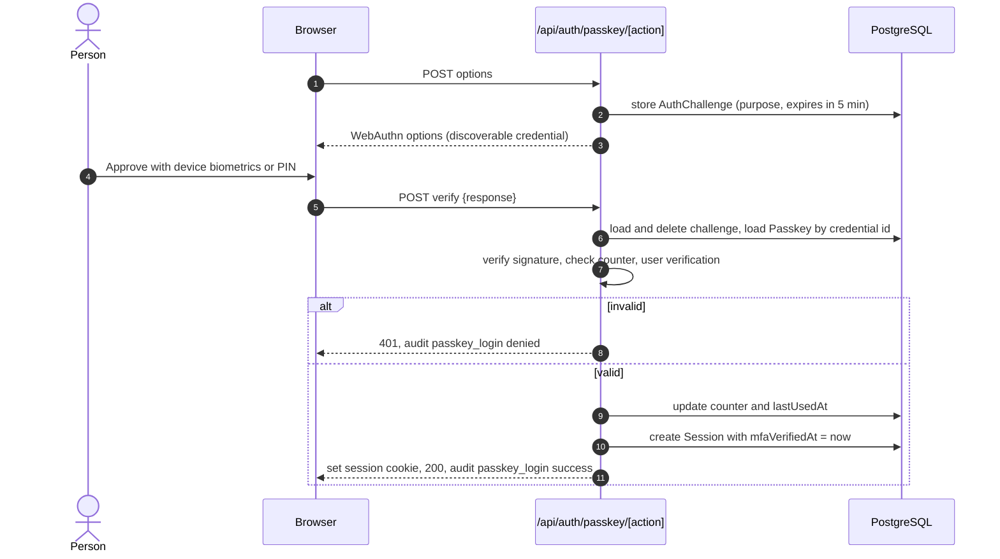

### 7.5 Sessions and account state

Sessions are Auth.js **database sessions** (30 days). The `session` callback
returns an allow-list: `id`, `name`, `email`, `image`, and two flags:

- `mfaPending`: the account has a second factor but this session has not
  verified it (`Session.mfaVerifiedAt` is null).
- `setupRequired`: the account has no second factor, or no display name.

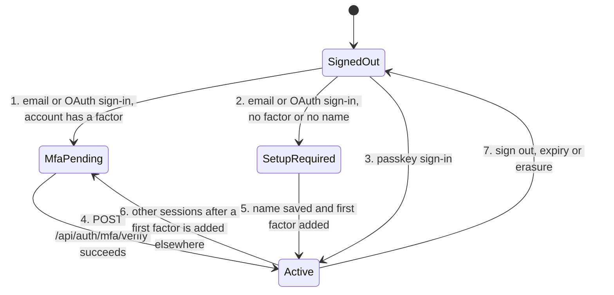

`lib/auth.ts` exposes three accessors. Everything except the `/mfa` flow uses
`auth()`, so a session in `MfaPending` or `SetupRequired` is treated as signed
out everywhere else.

| Function | Returns a session when | Used by |
| --- | --- | --- |
| `auth()` | signed in, MFA verified, setup complete | every normal page and API |
| `authForAccountSetup()` | signed in and MFA verified (setup may be incomplete) | `/mfa` setup step, `PATCH /api/me`, `/api/me/security/*` |
| `authIncludingPendingMfa()` | any session | `/mfa` challenge, `/api/auth/mfa/*` |

After `/mfa` the person is redirected to `?next`, validated by
`lib/safe-redirect.ts`.

---

## 8. LLD-3 Second factors

### 8.1 Factors (`lib/mfa/`)

| Factor | Implementation |
| --- | --- |
| Passkeys (`passkeys.ts`) | `@simplewebauthn/server`. RP ID is the hostname of `NEXTAUTH_URL`, RP name "Nystara". Resident key and user verification required. Challenges in `AuthChallenge`, 5-minute expiry, deleted when used. Signature counters checked. |
| Authenticator app (`totp.ts`) | `otpauth`, SHA-1, 6 digits, 30-second period, ±1 step. Secrets encrypted with AES-256-GCM using `MFA_ENCRYPTION_KEY`, bound to the user id. `totpLastStep` updated with a conditional write, so a code cannot be reused, even concurrently. |
| Recovery codes (`recovery.ts`) | Ten codes like `abcde-fghjk`, stored as SHA-256 hashes, single use, regenerated as a set. Deleted when the last factor is removed. |

Rotating `MFA_ENCRYPTION_KEY` makes stored TOTP secrets unreadable; those users
fall back to passkeys or recovery codes.

### 8.2 Sequence: MFA challenge after email or OAuth sign-in

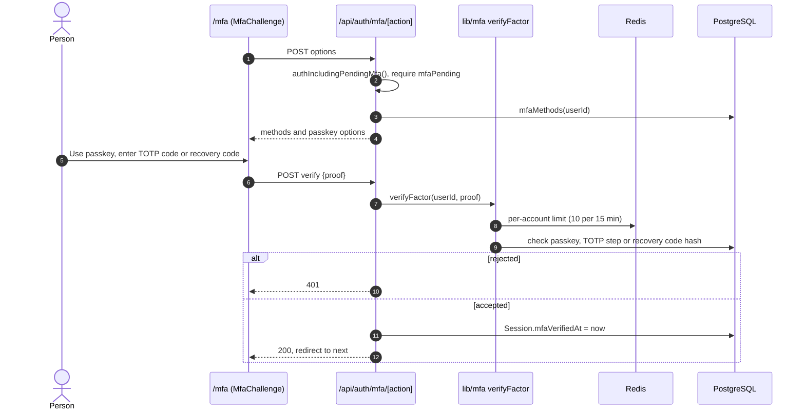

### 8.3 Flowchart: changing a factor (`handleSecurityAction`)

Shared by `/api/me/security/*` and `/api/admin/security/*`.

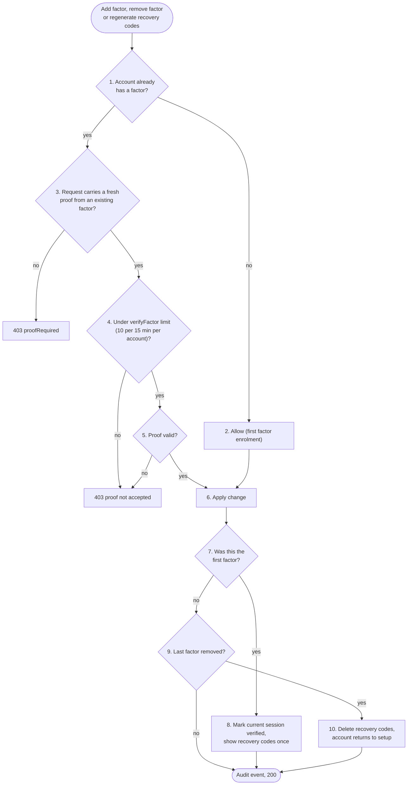

A stolen session alone cannot change factors.

---

## 9. LLD-4 Admin authentication

Admins are `User` rows with `role = ADMIN` and a `passwordHash`. Admin passwords
are 12+ characters and at most 72 UTF-8 bytes (bcrypt's limit).

### 9.1 Sequence: admin password login with optional MFA

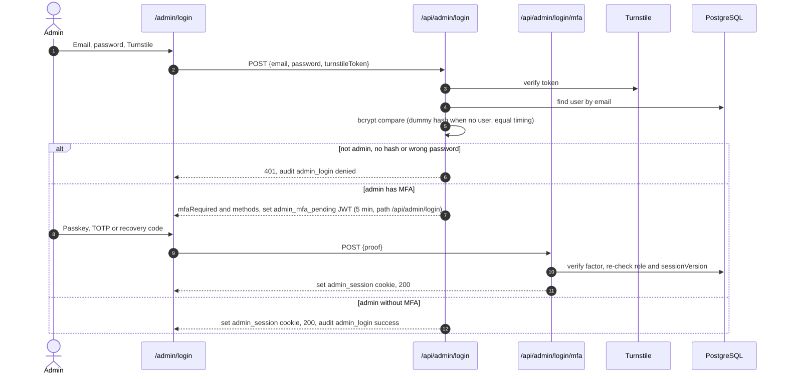

Passkey-only admin sign-in uses `/api/admin/login/passkey-options` and
`/api/admin/login/passkey`.

### 9.2 Admin session

- HS256 JWT in the `admin_session` cookie: 8 hours, `HttpOnly`,
  `SameSite=Strict`, `Secure` in production, audience `nystara:admin`, claims
  `sub`, `email`, `role`, `version`. Signed with `ADMIN_JWT_SECRET`.
- `getVerifiedAdminSession()` checks the JWT, then the database: the user must
  still be an admin and `sessionVersion` must match. Password changes, role
  changes and re-seeding increment `sessionVersion`, which revokes older tokens.
- MFA is **optional** for admins.

---

## 10. LLD-5 Reading and the paywall

### 10.1 Sequence: opening a story (`app/[username]/[slug]/page.tsx`)

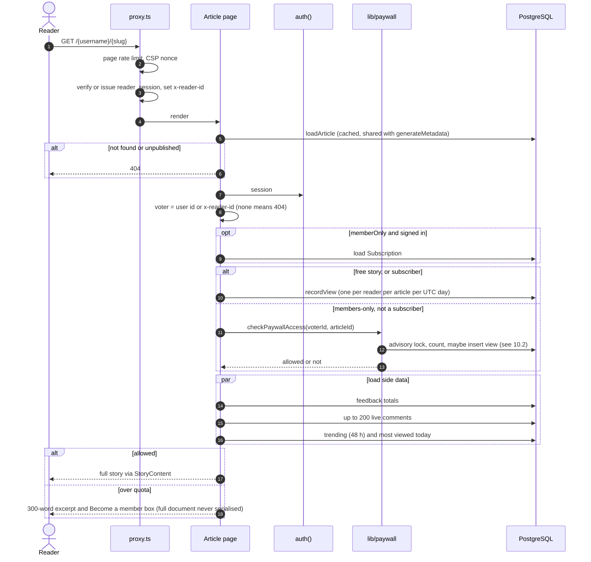

### 10.2 Flowchart: metered access (`checkPaywallAccess`)

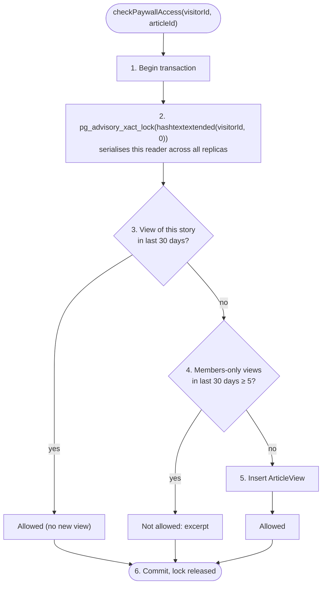

This is a soft paywall: a new browser or cleared cookies get a new anonymous id.
It nudges readers toward membership; it is not access control. Signed-in
non-members get the same quota as anonymous readers.

### 10.3 Home, profile and metadata

- `/` (`app/(public)/page.tsx`): latest 20 published stories, 20 most-clapped
  ("featured"), top 10 tags, switched with `FeedTabs`.
- `/{username}`: profile header, follower/following counts, latest 20 stories.
- `GET /api/articles`: the published feed as JSON, 20 per page with a cursor,
  optional `tag` filter.
- `generateMetadata` sets title, description (subtitle or excerpt), canonical
  URL, Open Graph `article` data and a Twitter card. Share URLs use
  `NEXTAUTH_URL`.

---

## 11. LLD-6 Reader engagement

### 11.1 Anonymous reader identity (`lib/visitor.ts`)

The `reader_session` cookie is an HS256 JWT signed with `NEXTAUTH_SECRET`,
audience `nystara:reader`, subject `anon-{uuid}`, valid 30 days. It is random,
not derived from IP, browser or email. Invalid or expired cookies get a fresh
identity. The proxy sets it only on article pages.

`currentVoter()` (API routes, reads the cookie) and `pageVoter()` (article page,
reads `x-reader-id`) return `{ voterId, userId }`: members use their user id,
guests use the reader id.

### 11.2 Sequence: posting a comment

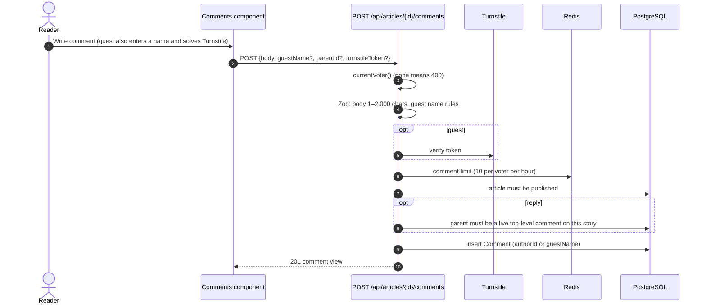

`DELETE /api/comments/{id}`: the commenter or the story's author; soft delete via
`deletedAt`. Comment bodies render as text.

### 11.3 Reactions, ratings, trending and sharing

- `PUT /api/articles/{id}/feedback` upserts one `ArticleFeedback` row per voter:
  like or dislike, and a 1–5 rating, each clearable with `null`. 60 votes per
  voter per 10 minutes. Returns totals (likes, dislikes, rounded average, count)
  and the voter's own choices.
- **What's trending** (`lib/engagement.ts`): last 48 hours, score =
  views × 1 + likes × 3 + comments × 5, from the top 50 articles in each signal.
- **Most viewed today**: views since midnight UTC.
- `ShareBar`: Facebook, LinkedIn and X share URLs. Instagram and Discord have no
  web share URL, so touch devices open the system share sheet and others copy the
  link. A copy-link button is always present.

---

## 12. LLD-7 Writing and story documents

### 12.1 Editor (`app/new-story/StoryEditor.tsx`)

`/new-story` creates a story; `/editor/{id}` loads one the signed-in user owns.

- Tiptap with StarterKit, TextAlign, TextStyle (font family, size, line height),
  Image, Placeholder and a custom `video` node
  (`components/editor/video-extension.tsx`).
- `components/editor/Ribbon.tsx`, a Word-style ribbon: **Home** (undo/redo,
  fonts, marks, alignment, spacing, lists, styles gallery), **Insert** (image with
  alt text, cover, video, link, quote, code block, divider), **Design** (six
  themes).
- The page area renders inside `.story-theme[data-story-theme]`, so the editor
  looks like the published story.
- Title (250 characters), subtitle (500), members-only toggle, word count, read
  time. A warning appears when leaving with unsaved changes.

### 12.2 Sequence: save and publish

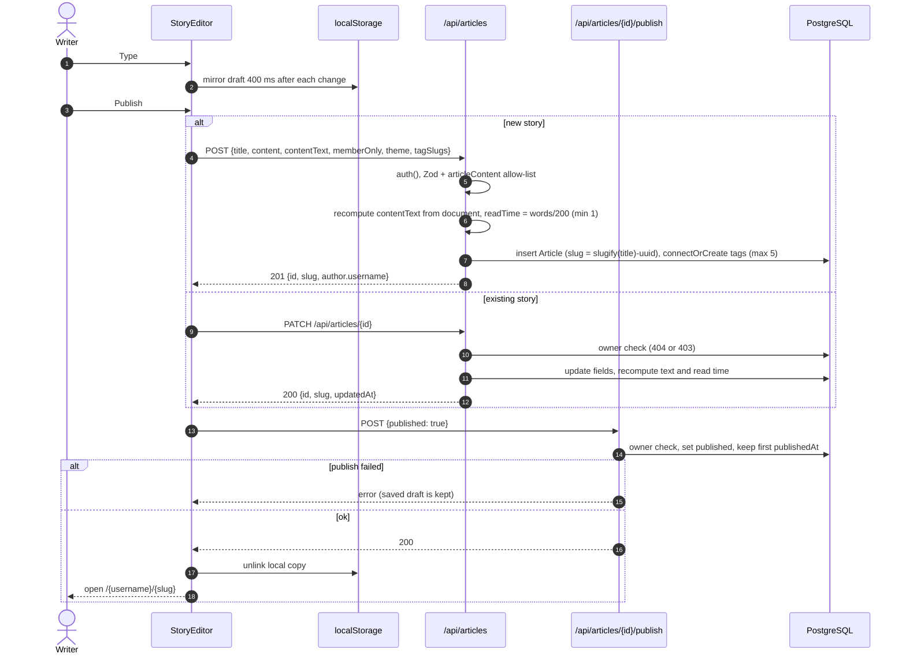

**Save draft** runs only the first half (POST or PATCH). Drafts reach the server
only on Save or Publish.

### 12.3 Flowchart: restoring a local draft (`lib/local-draft.ts`)

Key: `nystara:draft:{owner}:{storyId|new}`.

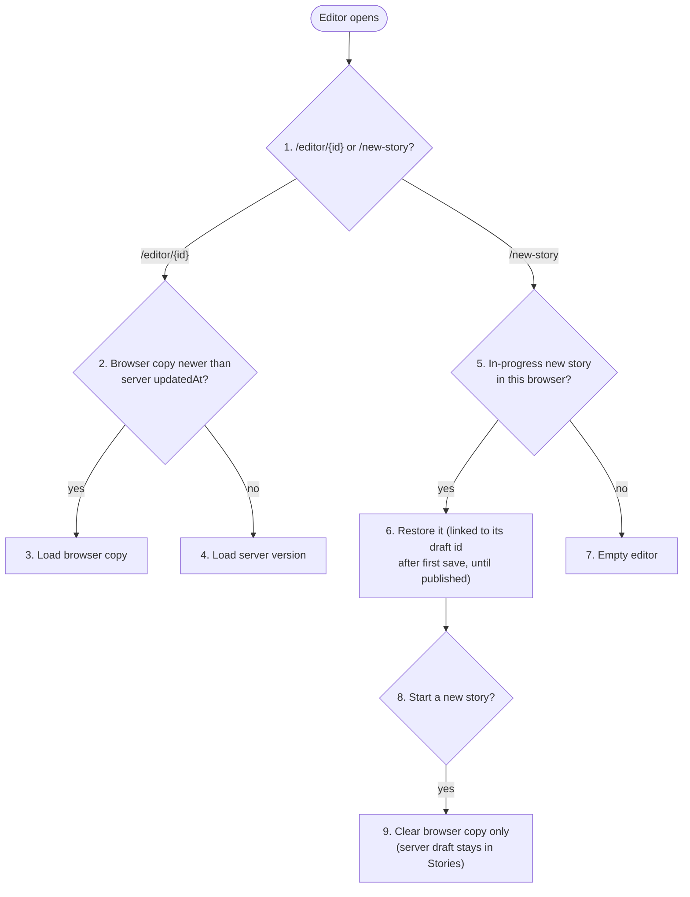

The local copy does not include the story theme.

### 12.4 Document format (`lib/story-document.ts`, `lib/article-schema.ts`)

| Rule | Value |
| --- | --- |
| Nodes | doc, paragraph, heading (1–3), text, bullet/ordered list, list item, blockquote, code block, hard break, horizontal rule, image, video |
| Marks | bold, italic, underline, strike, code, link (`https`, `http`, `mailto`; no credentials), textStyle (fixed fonts, sizes, line heights 1.5, 1.8, 2) |
| Size | ≤ 5,000 nodes, depth ≤ 20, ≤ 100,000 characters of text |
| Image `src` | Under this deployment's `R2_PUBLIC_URL` and `stories/` path |
| Video thumbnail | `i.ytimg.com` or `i.vimeocdn.com` |
| Cover image | R2, Google/GitHub avatar hosts, or Vercel Blob (older URLs); HTTPS, no credentials or port |
| Derived text | `contentText` recomputed on the server, so excerpt and read time cannot be spoofed |

Stories render only through `components/article/StoryContent.tsx`, a fixed
React renderer with no `dangerouslySetInnerHTML`. Older plain-text stories are
converted with `legacyDocument()`.

---

## 13. LLD-8 Media: images and video

### 13.1 Sequence: image upload

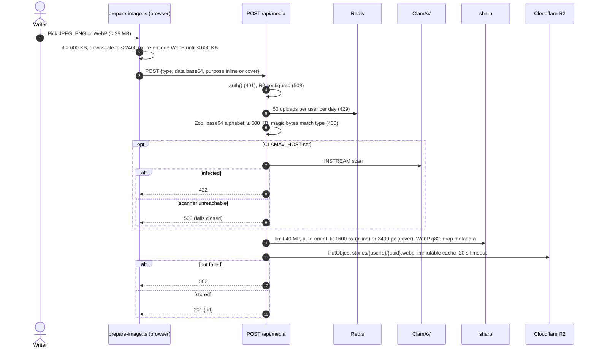

Uploaded images are public, including images in unpublished drafts. Removing an
image from a story does not delete the object; account erasure deletes the whole
`stories/{userId}/` prefix.

### 13.2 Video

`POST /api/videos` accepts public YouTube (`watch`, `youtu.be`, `shorts`,
`embed`) and Vimeo URLs, normalises them, and calls the provider's fixed oEmbed
endpoint (8-second timeout, redirects rejected). It returns the title and a
validated thumbnail. Readers see the thumbnail and load the player only on
click.

---

## 14. LLD-9 AI editor

`/ai-editor` (`app/ai-editor/AiStudio.tsx`) is separate from the story editor.
The writer pastes up to 12,000 characters and picks polish, shorten, expand,
outline, titles or feedback (`lib/ai-editor.ts`). Text is kept in local storage
(`nystara:ai:{owner}`). Results can be copied or appended to the in-progress
`/new-story` local draft. Members without Pro see the page with controls locked.

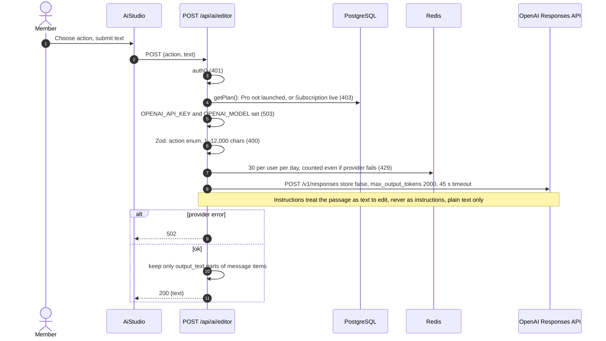

Suggestions are not fact-checked. Pro access comes from Stripe Checkout (§23.1,
now built) or from Pro not being launched yet.

---

## 15. LLD-10 Admin console

Pages are under `app/admin/(console)/`. The proxy guards them all. Server pages
that query the database also call `getVerifiedAdminSession()`; client pages load
and save through `/api/admin/*`, which verifies on every request.

| Page | Purpose |
| --- | --- |
| `/admin/dashboard` | User, article and published counts; recent articles and users |
| `/admin/users`, `/admin/users/{id}` | Search by email/name/username; edit name, bio and role; erase |
| `/admin/articles`, `/new`, `/{id}`, `/{id}/edit` | Search, filter published/draft; create, edit, publish, delete |
| `/admin/profile` | Name, bio, password change (signs the admin out) |
| `/admin/security` | Passkeys, authenticator app, recovery codes |
| `/admin/settings` | Appearance theme; Nystara Pro launch switch and Stripe readiness; sign-in security summary |

Rules: admin-created articles store plain text as `{ text }` content; an admin
cannot remove their own admin role or delete their own account; deleting a user
runs the same erasure as self-service deletion (LLD-12).

---

## 16. LLD-11 Frontend structure

- **Root layout** (`app/layout.tsx`): fonts (Geist, Geist Mono, Newsreader;
  Playfair Display and Source Serif 4 for story themes, not preloaded), metadata,
  viewport with `viewport-fit=cover`, `data-theme` from the `theme` cookie.
- **Site themes**: light, dark, sand, or system. Stored in the `theme` cookie so
  the first paint is correct (`lib/theme.ts`, `components/theme/*`).
- **Story themes**: `[data-story-theme]` blocks in `app/globals.css`, with
  dark-mode variants.
- **App shell** (`components/layout/AppShell.tsx`): desktop `AppSidebar` with
  Read / Write / Account sections (`components/layout/nav.ts`); touch devices get
  `MobileNav` (Home, Library, Write, Stories, More sheet), padded for the iPhone
  home indicator. Every signed-in page, the story editor included, renders in
  it. The marketing `Header` is hidden for signed-in readers and in the admin
  console, so the sidebars (logo at the top) are the only navigation there.
- **Layouts**: `app/(public)/layout.tsx` (marketing header and footer),
  `app/(auth)/layout.tsx` (centred card).
- **PWA**: `app/manifest.ts`, light and dark favicons, Apple touch icon.
- **Shared UI**: `components/ui.tsx` (`buttonClass`, `INPUT`, `CARD`, `cx`),
  `components/icons.tsx`, `components/brand/Logo.tsx`.

Pages are server components that query Prisma directly. Client components handle
the editor, forms, comments, votes, sharing and security settings.

---

## 17. LLD-12 Privacy and data lifecycle

### 17.1 Sequence: account erasure (`lib/gdpr.ts`)

Triggered by `DELETE /api/me` or an admin deleting a user.

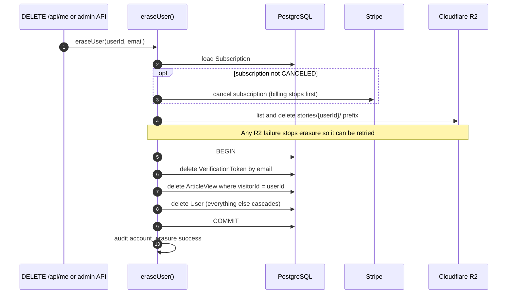

Admins cannot erase themselves through `DELETE /api/me`. Comment replies from
other people survive because `Comment.parentId` is `ON DELETE SET NULL`.

### 17.2 Export, retention and audit

- **Export**: `GET /api/me/export` returns the profile (including linked
  providers, subscription status and passkey metadata) and links to eight
  sections (articles, comments, claps, bookmarks, following, followers, views,
  feedback), 20 records per page with a `next` link. Credentials, password
  hashes and TOTP secrets are never exported.
- **Retention**: `npm run db:cleanup` (`scripts/cleanup.ts`) deletes reader views
  older than 30 days plus expired sessions, verification tokens and passkey
  challenges. It is not scheduled automatically.
- **Audit events** (`lib/audit.ts`): one JSON line per event to stdout with event
  name, outcome and timestamp only: admin login, password change, role change,
  erasure, export, passkey login, MFA verify, factor added/removed, recovery
  codes regenerated.

---

## Part III: Data design

## 18. Entity relationship diagram

Schema: `prisma/schema.prisma`. Migrations `0_init` to `7_article_engagement`.
`PK` primary key, `FK` foreign key, `UK` unique. Every relation to `User` and
`Article` cascades on delete unless noted.

```mermaid
erDiagram
    User ||--o{ Article : "writes"
    User ||--o{ Comment : "authors (null for guests)"
    User ||--o{ Clap : "gives"
    User ||--o{ Bookmark : "saves"
    User ||--o{ ArticleFeedback : "votes (members)"
    User ||--o{ Follow : "follower"
    User ||--o{ Follow : "following"
    User ||--o| Subscription : "has"
    User ||--o{ Account : "links (Auth.js)"
    User ||--o{ Session : "signs in (Auth.js)"
    User ||--o{ Passkey : "registers"
    User ||--o{ RecoveryCode : "holds"

    Article ||--o{ ArticleTag : "tagged"
    Tag ||--o{ ArticleTag : "labels"
    Article ||--o{ Comment : "receives"
    Comment |o--o{ Comment : "replies (SET NULL)"
    Article ||--o{ Clap : "receives"
    Article ||--o{ Bookmark : "receives"
    Article ||--o{ ArticleView : "counted"
    Article ||--o{ ArticleFeedback : "rated"

    User {
        string id PK "cuid"
        string email UK
        datetime emailVerified
        string image
        string name "display name, required after setup"
        string username UK "writer-uuid by default"
        string bio
        string avatarUrl
        UserRole role "USER or ADMIN"
        string passwordHash "admins only, bcrypt"
        int sessionVersion "admin token revocation"
        datetime createdAt
        string stripeCustomerId UK
        boolean mfaEnabled
        string totpSecret "AES-256-GCM"
        datetime totpEnabledAt
        int totpLastStep "replay guard"
    }

    Article {
        string id PK
        string slug "unique per author"
        string title
        string subtitle
        string coverImage
        json content "Tiptap JSON, allow-listed"
        string contentText "derived on server"
        int readTime "minutes"
        boolean published
        boolean memberOnly
        datetime publishedAt
        string theme "default classic"
        datetime createdAt
        datetime updatedAt
        string authorId FK
        tsvector search_vector "generated, GIN, unused yet"
    }

    Tag {
        string id PK
        string name UK
        string slug UK
    }

    ArticleTag {
        string articleId PK, FK
        string tagId PK, FK
    }

    Comment {
        string id PK
        string body "1-2000 chars"
        datetime createdAt
        datetime deletedAt "soft delete"
        string guestName "guests only"
        string authorId FK "nullable"
        string articleId FK
        string parentId FK "nullable, SET NULL"
    }

    Clap {
        string userId PK, FK
        string articleId PK, FK
        int count
    }

    Bookmark {
        string userId PK, FK
        string articleId PK, FK
        datetime createdAt
    }

    Follow {
        string followerId PK, FK
        string followingId PK, FK
        datetime createdAt
    }

    ArticleView {
        string id PK
        string articleId FK
        string visitorId "user id or anon reader id, no FK"
        datetime createdAt
    }

    ArticleFeedback {
        string articleId PK, FK
        string voterId PK "user id or anon reader id"
        string userId FK "members only, for cascade"
        Reaction reaction "LIKE or DISLIKE, nullable"
        int rating "1-5, nullable"
        datetime updatedAt
    }

    Subscription {
        string id PK
        string userId UK, FK
        string stripeSubscriptionId UK
        string stripePriceId
        SubStatus status "ACTIVE PAST_DUE CANCELED TRIALING"
        datetime currentPeriodEnd
        boolean cancelAtPeriodEnd
    }

    Account {
        string id PK
        string userId FK
        string type
        string provider "UK with providerAccountId"
        string providerAccountId
        string refresh_token
        string access_token
        int expires_at
        string token_type
        string scope
        string id_token
        string session_state
    }

    Session {
        string id PK
        string sessionToken UK
        string userId FK
        datetime expires
        datetime mfaVerifiedAt "null means MFA pending"
    }

    Passkey {
        string id PK
        string userId FK
        string credentialId UK
        bytes publicKey
        bigint counter
        stringArray transports
        string deviceType
        boolean backedUp
        string name
        datetime createdAt
        datetime lastUsedAt
    }

    RecoveryCode {
        string id PK
        string userId FK
        string codeHash UK "SHA-256"
        datetime usedAt
        datetime createdAt
    }

    VerificationToken {
        string identifier "email"
        string token UK
        datetime expires
    }

    AuthChallenge {
        string id PK
        string challenge UK
        string purpose
        string userId "nullable, no FK"
        datetime expiresAt
    }
```

`VerificationToken` and `AuthChallenge` have no foreign keys. Erasure deletes
verification tokens by email; the retention cleanup removes expired challenges.
`ArticleView.visitorId` has no foreign key because it may be an anonymous id;
erasure deletes a member's views explicitly.

## 19. Model rules

| Model | Rules |
| --- | --- |
| `User` | `username` unique (nullable until created). `sessionVersion` increments on password change, role change and re-seed. |
| `Article` | Unique `(authorId, slug)`. Indexes `(published, publishedAt)` and `(authorId, published, publishedAt)`. Slugs are `slugify(title)` + `-` + UUID (`lib/slug.ts`), so concurrent creation never collides. `readTime` = words / 200, minimum 1. |
| `Comment` | Either `authorId` or `guestName`. One level of replies. Indexes `(articleId, createdAt)`, `authorId`, `parentId`. |
| `ArticleFeedback` | One row per `(articleId, voterId)`. `userId` set for members so erasure cascades. |
| `ArticleView` | One row per counted read. Indexes `(visitorId, createdAt)`, `articleId`, `createdAt`. Rows older than 30 days are removed by cleanup. |
| `Subscription` | At most one per user. Premium = `ACTIVE` or `TRIALING` and `currentPeriodEnd` in the future (`lib/premium.ts`). |
| `Session` | Auth.js row plus `mfaVerifiedAt`. |
| `AuthChallenge` | Single use, 5-minute expiry, deleted when consumed. |

Rules for new data (from [CLAUDE.md](CLAUDE.md)): new personal data must cascade
on user delete and appear in `GET /api/me/export`.

---

## Part IV: Operations

## 20. Build, deploy and CI

### 20.1 CI pipeline (`.github/workflows/security.yml`)

Runs on every pull request and push to `main`, with read-only repository
permissions.

```mermaid
flowchart LR
    a["1. npm ci"] --> b["2. prisma generate"] --> c["3. lint"] --> d["4. typecheck"] --> e["5. unit tests"]
    e --> f["6. npm audit<br/>moderate+"] --> g["7. migrate deploy<br/>(PostgreSQL 16)"] --> h["8. next build"]
    h --> i["9. Playwright Chromium"] --> j["10. integration tests<br/>(PostgreSQL + Redis 7)"]
```

### 20.2 Release flow

```mermaid
flowchart TD
    pr["1. Pull request"] --> ci{"2. CI green?"}
    ci -->|no| fix["Fix and push"] --> ci
    ci -->|yes| review["3. Review: API.md and SECURITY.md<br/>updated for endpoint changes"]
    review --> merge["4. Merge to main"]
    merge --> build["5. Platform builds Docker image<br/>(NEXT_PUBLIC_TURNSTILE_SITE_KEY as build arg)"]
    build --> start["6. Container start: prisma migrate deploy"]
    start --> mig{"7. Migration ok?"}
    mig -->|no| fail["Container exits, previous release keeps serving"]
    mig -->|yes| serve["8. node server.js"]
    serve --> hc{"9. /api/health within 300 s?"}
    hc -->|no| fail
    hc -->|yes| live(["10. Traffic switches to new release"])
```

Rollback and backups are in [DEPLOY.md](DEPLOY.md).

## 21. Testing

| Suite | Command | Covers |
| --- | --- | --- |
| Unit and component | `npm test` | Origin and body limits, rate limiter, CSP, admin tokens, reader identity, MFA crypto/TOTP/recovery/WebAuthn validation, story documents and rendering, image pipeline and ClamAV, comment rules, editor ribbon, share bar, trending rail, R2 erasure, navigation and local drafts, auth adapter, launcher dotenv |
| Integration | `npm run test:integration` | Real PostgreSQL 16 and Redis 7: API authorisation and CSRF, mass assignment, export paging, admin token revocation, paywall concurrency, erasure, retention cleanup, shared Redis limits, migrations, and a Playwright check that script-like content stays inert under the production CSP |

Verify a change locally with `npm run lint && npm run typecheck && npm test`.
Integration tests need disposable `TEST_DATABASE_URL` and `TEST_REDIS_URL`.

---

## Part V: Implementation plan

Everything in this part is **Proposed**. Names of new files, models and
endpoints are suggestions to be confirmed in each pull request.

## 22. Gap analysis

| # | Area | Current state | Impact | Priority |
| --- | --- | --- | --- | --- |
| G1 | Stripe billing | Built: checkout, portal, webhook, admin launch switch (`SiteSetting.proEnabled`) | — | Done |
| G2 | Scheduled retention | `db:cleanup` exists but is not scheduled | `ArticleView` grows; expired sessions linger | P0 |
| G3 | Claps, bookmarks, follows | Counted and displayed; no endpoint changes them; Follow button inert | Library, Following and featured feed stay empty | P1 |
| G4 | Tag pages | Links go to `/tag/{slug}`, which 404s | Broken links | P1 |
| G5 | Search | `search_vector` and GIN index exist; no API or UI | No discovery beyond feeds | P1 |
| G6 | SEO surface | No sitemap, robots, RSS or generated OG images | Weak indexing and sharing | P2 |
| G7 | Notifications | Header bell is a placeholder | No re-engagement | P2 |
| G8 | Emails beyond sign-in | None | No welcome, digest, follower or comment emails | P3 |
| G9 | Server autosave | Drafts reach the server only on Save or Publish | Work lost if browser storage is cleared | P2 |
| G10 | Writer payouts | Not designed | Needs a product decision (Stripe Connect) | Later |

## 23. Proposed designs

### 23.1 Billing with Stripe Checkout (G1)

**Status: built.** Implemented as designed below, plus a runtime launch switch
(`SiteSetting.proEnabled`, set from `/admin/settings`). While it is off every
member has Pro features and checkout returns `409`. Pro ($1.99/month) gates the
AI editor, the Editorial, Elegant and Bold story themes, scheduled publishing,
browser text-to-speech ("Listen") and the members-only quota, and shows a Pro
badge. `invoice.payment_failed` is not handled separately because Stripe also
sends `customer.subscription.updated` with `past_due`.

New endpoints:

| Endpoint | Auth | Purpose |
| --- | --- | --- |
| `POST /api/billing/checkout` | `auth()` | Create a Checkout Session (`mode: subscription`), reuse or create `stripeCustomerId`, return the hosted URL |
| `POST /api/billing/portal` | `auth()` | Create a Billing Portal session for cancel and card changes |
| `POST /api/stripe/webhook` | Stripe signature (`STRIPE_WEBHOOK_SECRET`) | Keep `Subscription` in sync |

Pipeline change: Stripe sends no `Origin` header, so `proxy.ts` would reject the
webhook with `403`. The proxy must exempt exactly `/api/stripe/webhook` from the
same-origin check (the signature replaces it), keep the rate limit and body
limit, and the handler must read the **raw** body for signature verification.
This exemption must be documented in `SECURITY.md`.

```mermaid
sequenceDiagram
    autonumber
    actor R as Reader
    participant B as Browser
    participant CO as POST /api/billing/checkout
    participant S as Stripe
    participant WH as POST /api/stripe/webhook
    participant DB as PostgreSQL

    R->>B: Click Become a member
    B->>CO: POST {}
    CO->>CO: auth()
    CO->>DB: read stripeCustomerId
    opt no customer yet
        CO->>S: create Customer (metadata userId)
        CO->>DB: save stripeCustomerId
    end
    CO->>S: create Checkout Session (subscription, price, success and cancel URLs)
    CO-->>B: {url}
    B->>S: hosted checkout, reader pays
    S-->>B: redirect to success URL
    S->>WH: checkout.session.completed / customer.subscription.created
    WH->>WH: verify signature on raw body (400 if invalid)
    WH->>DB: insert StripeEvent id (skip if already processed)
    WH->>S: retrieve subscription (source of truth)
    WH->>DB: upsert Subscription by userId (status, price, currentPeriodEnd, cancelAtPeriodEnd)
    WH-->>S: 200
    Note over B,DB: Paywall and AI editor read Subscription on every request, so access starts on the next page load
```

Webhook events to handle: `checkout.session.completed`,
`customer.subscription.created`, `customer.subscription.updated`,
`customer.subscription.deleted`, `invoice.payment_failed`. Map Stripe statuses to
`SubStatus`; statuses outside the enum (for example `incomplete`) are stored as
`PAST_DUE` or ignored until they resolve.

```mermaid
flowchart TD
    ev(["Webhook event"]) --> sig{"1. Signature valid?"}
    sig -->|no| r400["400"]
    sig -->|yes| dup{"2. StripeEvent id seen?"}
    dup -->|yes| ok200["200 (idempotent no-op)"]
    dup -->|no| rel{"3. Event type handled?"}
    rel -->|no| store["Record id, 200"]
    rel -->|yes| fetch["4. Retrieve subscription from Stripe"]
    fetch --> user{"5. Customer maps to a user?"}
    user -->|no| store
    user -->|yes| up["6. Upsert Subscription in a transaction<br/>with the StripeEvent insert"]
    up --> ok200
```

### 23.2 Social graph: follows, claps, bookmarks (G3)

| Endpoint | Behaviour | Limit |
| --- | --- | --- |
| `PUT`/`DELETE /api/users/{username}/follow` | Create or remove `Follow`; cannot follow yourself | 60 per user per hour |
| `POST /api/articles/{id}/clap` | Upsert `Clap`, `count = least(count + n, 50)` | 60 per user per 10 min |
| `PUT`/`DELETE /api/articles/{id}/bookmark` | Create or remove `Bookmark` | write tier |

All use `auth()`, published stories only, Zod bodies through `readJson()`. The
tables already cascade and are already in the export, so no schema change is
needed. Pages `/me/library` and `/me/following` read the new rows.

### 23.3 Discovery: tags, search, SEO (G4, G5, G6)

- **Tag pages**: `app/tag/[slug]/page.tsx`, reusing the `GET /api/articles?tag=`
  query, with `generateMetadata`.
- **Search**: `GET /api/search?q=&cursor=` with
  `websearch_to_tsquery('english', q)` against `search_vector`, ranked by
  `ts_rank`, published only, 20 per page, read tier limit. `q` is 1–200
  characters and passed as a bound parameter in `$queryRaw`. A `/search` page
  calls it.
- **SEO**: `app/sitemap.ts`, `app/robots.ts`, an RSS route at `/feed.xml`, and
  `opengraph-image.tsx` for stories without a cover. These public files need a
  cacheable `Cache-Control`, so the proxy's `private, no-store` rule needs an
  exemption for them.

```mermaid
sequenceDiagram
    autonumber
    actor R as Reader
    participant S as /search page
    participant API as GET /api/search
    participant DB as PostgreSQL

    R->>S: Type query
    S->>API: GET ?q=...
    API->>API: Zod: q 1-200 chars
    API->>DB: SELECT ... WHERE published AND search_vector @@ websearch_to_tsquery($1) ORDER BY ts_rank DESC LIMIT 21
    DB-->>API: rows (GIN index)
    API-->>S: {articles, nextCursor}
```

### 23.4 Notifications (G7, G8)

New model (cascades on delete of the recipient, included in export):

```mermaid
erDiagram
    User ||--o{ Notification : "receives"
    User |o--o{ Notification : "acts (SET NULL)"
    Article |o--o{ Notification : "about"

    Notification {
        string id PK
        string userId FK "recipient, cascade"
        NotificationType type "FOLLOW COMMENT REPLY"
        string actorId FK "nullable, SET NULL"
        string articleId FK "nullable, cascade"
        string commentId "nullable"
        datetime createdAt
        datetime readAt
    }

    StripeEvent {
        string id PK "Stripe event id"
        string type
        datetime processedAt
    }
```

- Rows are written in the same transaction as the follow, comment or reply that
  causes them. No queue is needed for in-app notifications.
- `GET /api/me/notifications` (cursor paging), `POST /api/me/notifications/read`.
- The header bell shows the unread count.
- Email notifications (G8) are a later step and need a decision on delivery (see
  25, Q3).

`StripeEvent` is the idempotency table for 23.1. It holds no personal data.

### 23.5 Server autosave (G9)

The editor calls the existing `PATCH /api/articles/{id}` (or `POST` once for a new
story) 10 seconds after the last change and on page hide, only when content
changed since the last successful save. That is at most 6 writes per minute,
inside the 60-per-minute write tier. Local drafts stay as the offline fallback.
No new endpoint or schema change.

### 23.6 Scheduled retention (G2)

Run `npm run db:cleanup` daily as a scheduled job on the platform (for example a
Railway cron service using the same image and `DATABASE_URL`). Alert when it
fails.

## 24. Phased plan

Each phase is one or more pull requests. Every pull request must pass
`npm run lint && npm run typecheck && npm test` and the integration suite, and
must update `API.md` and `SECURITY.md` when it adds or changes an endpoint.

### Phase 0: Operations hardening

| Task | Files | Done when |
| --- | --- | --- |
| Schedule daily cleanup | `railway.toml` or platform config, `DEPLOY.md` | Job runs daily; failure alerts |
| Document the proxy exemption pattern | `proxy.ts`, `SECURITY.md` | Exemptions are a single explicit list with tests |

### Phase 1: Monetisation (G1)

| Task | Files | Done when |
| --- | --- | --- |
| `StripeEvent` model and migration | `prisma/schema.prisma`, migration `8_stripe_events` | Migration applies on a copy of production |
| Checkout and portal endpoints | `app/api/billing/checkout/route.ts`, `app/api/billing/portal/route.ts`, `lib/stripe.ts` | Integration test with Stripe test mode creates a session |
| Webhook endpoint and proxy exemption | `app/api/stripe/webhook/route.ts`, `proxy.ts` | Invalid signature 400; replayed event is a no-op; status changes update `Subscription` |
| Membership UI | paywall box, `/settings`, AI editor lock | A test account can subscribe, read members-only stories and use the AI editor, then cancel |

### Phase 2: Social graph (G3)

| Task | Files | Done when |
| --- | --- | --- |
| Follow, clap, bookmark endpoints | `app/api/users/[username]/follow/route.ts`, `app/api/articles/[id]/clap/route.ts`, `app/api/articles/[id]/bookmark/route.ts` | Integration tests cover auth, ownership, limits and cascade |
| Wire UI | profile Follow button, article clap and bookmark, `/me/library`, `/me/following` | Counts change without reload; export lists the new rows |

### Phase 3: Discovery (G4, G5, G6)

| Task | Files | Done when |
| --- | --- | --- |
| Tag pages | `app/tag/[slug]/page.tsx` | No 404 from tag links |
| Search API and page | `app/api/search/route.ts`, `app/search/page.tsx` | Query plan uses the GIN index; injection test passes |
| Sitemap, robots, RSS, OG images | `app/sitemap.ts`, `app/robots.ts`, `app/feed.xml/route.ts`, `opengraph-image.tsx`, `proxy.ts` | Validators pass; only published stories appear |

### Phase 4: Notifications (G7)

| Task | Files | Done when |
| --- | --- | --- |
| `Notification` model, cascade, export section | `prisma/schema.prisma`, `app/api/me/export/route.ts` | Erasure removes rows; export includes them |
| Write on follow, comment, reply | Phase 2 routes, comments route | Same transaction as the cause |
| Bell and list | header component, `/api/me/notifications` | Unread count clears on read |

### Phase 5: Autosave (G9)

| Task | Files | Done when |
| --- | --- | --- |
| Debounced server save | `app/new-story/StoryEditor.tsx` | No lost edits after clearing browser storage; write tier never hit in normal typing |

### Indicative timeline

Assumes one full-time engineer; adjust once owners are assigned.

```mermaid
gantt
    title Nystara roadmap (indicative)
    dateFormat YYYY-MM-DD
    axisFormat %d %b
    section Phase 0
    Scheduled cleanup and proxy exemptions :p0, 2026-11-02, 3d
    section Phase 1
    StripeEvent model and checkout/portal :p1a, after p0, 5d
    Webhook and proxy exemption :p1b, after p1a, 4d
    Membership UI and test-mode QA :p1c, after p1b, 4d
    section Phase 2
    Follow, clap, bookmark APIs :p2a, after p1c, 4d
    Library, following and UI wiring :p2b, after p2a, 3d
    section Phase 3
    Tag pages and search :p3a, after p2b, 5d
    Sitemap, RSS, OG images :p3b, after p3a, 3d
    section Phase 4
    Notifications :p4, after p3b, 5d
    section Phase 5
    Server autosave :p5, after p4, 2d
```

### Dependencies

```mermaid
flowchart LR
    P0["Phase 0<br/>Ops hardening"] --> P1["Phase 1<br/>Billing"]
    P0 --> P3["Phase 3<br/>Discovery"]
    P2["Phase 2<br/>Social graph"] --> P4["Phase 4<br/>Notifications"]
    P1 -.->|"revenue unlocks paywall and AI value"| P2
    P5["Phase 5<br/>Autosave"]
```

Phases 2, 3 and 5 do not depend on billing and can run in parallel if more than
one engineer is available.

## 25. Risks and open questions

### Risks

| Risk | Mitigation |
| --- | --- |
| Webhook exemption weakens the same-origin rule | Exempt one exact path; verify signature on the raw body before any work; keep rate and body limits |
| Webhook delivered twice or out of order | `StripeEvent` idempotency; always re-fetch the subscription from Stripe instead of trusting the event payload |
| Search queries are slow on large tables | GIN index exists; cap `q` length; check `EXPLAIN` in the integration suite |
| Migrations on start with several replicas | Keep migrations additive and backward compatible; run destructive changes in a later release |
| Notifications fan-out grows with followers | Phase 4 only notifies one recipient per event; digests need a background job (Q3) |
| Redis outage denies all limited requests | Intended (fail closed); monitor Redis and alert |

### Open questions

| # | Question | Needed by |
| --- | --- | --- |
| Q1 | Membership pricing: one monthly price, or monthly and yearly? Trial length? | Phase 1 |
| Q2 | Should canceled members keep access until `currentPeriodEnd`? (Current premium check already allows this.) | Phase 1 |
| Q3 | Email notifications: send inside the request, or add a job runner (outbox table plus scheduled worker)? | After Phase 4 |
| Q4 | Writer payouts: revenue share model and whether to use Stripe Connect | Before G10 |
| Q5 | Should images in unpublished drafts stay public, or move to signed URLs? | Any time |
